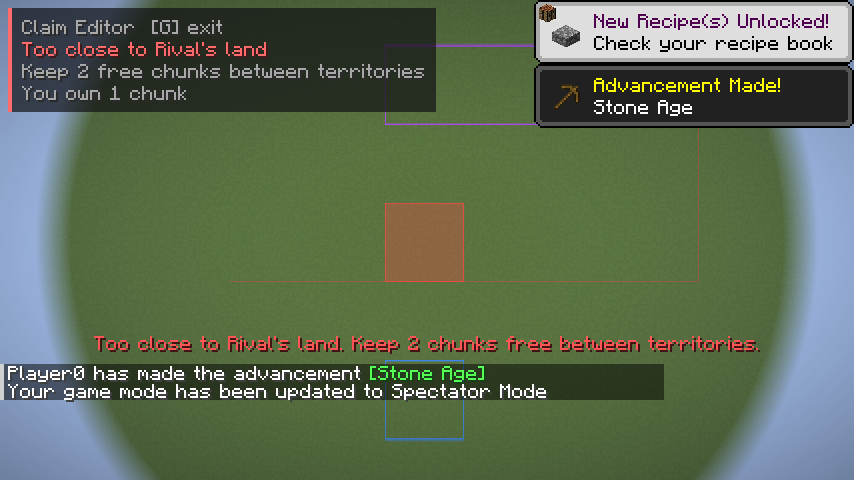
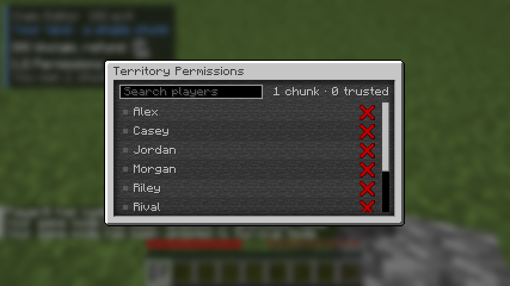

# Chunk Claims

A Fabric mod for Minecraft **26.3** that adds progressive, chunk-based land claiming to a
rule-free survival server. Players buy chunks with resources (cobblestone first, diamonds
later), trust other players per territory, and everyone else can walk in but cannot grief.

| Bird's-eye view in editing mode | Permissions menu |
|---|---|
|  |  |

Left: standing in a red (too close) chunk, with your blue territory below, a rival's purple
territory above, and the faint red edge of the rival's buffer zone between them.

**Handing it to a server owner:** send `dist/chunkclaims-1.0.0.jar` and `dist/PLAYTEST.md`
(install steps plus a two-player test checklist).

The full design and the reasoning behind each call is in
[docs/superpowers/specs/2026-10-28-chunk-claims-design.md](docs/superpowers/specs/2026-10-28-chunk-claims-design.md).

## Install

One jar does both jobs. Put `build/libs/chunkclaims-1.0.0.jar` plus
[Fabric API](https://modrinth.com/mod/fabric-api) `0.165.0+26.3` (or newer for 26.3) in:

- the **server's** `mods/` folder (claims, economy, protection), and
- each **player's** `mods/` folder (editing mode, overlay, permissions menu).

Players without the mod can still join. They are protected by claims and blocked by them
like anyone else; they just get no overlay or menu. Singleplayer works too.

Requirements: Fabric Loader 0.20.1+, Java 25.

## Playing

| Key (default) | What it does |
|---|---|
| **G** | Toggle claim editing mode |
| **H** | Claim the chunk you stand in if it is green, unclaim it if it is yours (edit mode) |
| **J** | Open the permissions menu for the territory you stand in (edit mode) |

Rebind them under Options > Controls > Key Binds > Chunk Claims.

In editing mode the ground shows:

| Colour | Meaning |
|---|---|
| Blue border | Your territory's outer edge |
| Light blue outline | The chunk of yours you are standing in |
| Green fill | You stand in a free chunk you can claim |
| Red fill | You stand in a free chunk that is too close to someone else's land |
| Faint red line | The edge of a no-claim buffer zone |
| Purple border | Another player's territory |

A panel in the top-left shows what the chunk is, the claim price or unclaim refund (with
item icons), and how many chunks you own.

**Permissions** are per territory: a group of your chunks connected edge to edge. Trusted
players can build, break, open containers and interact there like you can, but cannot
claim, unclaim or change permissions. When a new chunk joins two territories, only players
trusted in both keep access.

**Protection** for everyone else in a claim: no breaking, placing, container access, door
or button use, bucket use, item frame or armor stand tampering, hurting animals or
villagers (projectiles included), or crop trampling. Regardless of who did it, explosions
never damage claimed blocks, fluids cannot flow in from outside, pistons and dispensers
cannot reach in from outside, and fire never burns claimed blocks. PvP is untouched.

## Server config

`config/chunkclaims.json` is written with the defaults on first start; edit it and restart.

```jsonc
{
  "bufferChunks": 2,          // free chunks required between two players' land
  "refundPercent": 50,        // share of the current tier price returned on unclaim
  "claimableDimensions": [],  // e.g. ["minecraft:overworld"]; empty = everywhere
  "prices": [                 // chunk N costs the first tier whose upTo >= N
    { "upTo": 2,  "cost": [{ "item": "minecraft:cobblestone", "count": 32 }], "growEvery": 0, "growBy": 0, "maxCount": 0 },
    // ...
    { "upTo": 0,  "cost": [{ "item": "minecraft:diamond", "count": 32 }], "growEvery": 16, "growBy": 8, "maxCount": 64 }
  ]
}
```

`upTo: 0` marks the open-ended last tier. `growEvery`/`growBy` raise its price every N
chunks, up to `maxCount`. Default ladder: 32 cobblestone, 16 coal, 16 iron, 16 iron + 1
diamond, then 2 / 4 / 8 / 16 / 32+ diamonds.

The refund is half the price of the tier your newest chunk sits in, which is the price of
buying it back, so unclaiming and reclaiming can never make a profit.

Claims are stored in `<world>/chunkclaims/claims.json` (written atomically, previous copy
kept as `claims.json.bak`). If both are unreadable the server refuses to start rather than
run with every base unprotected.

## Project layout

```
src/main/java/com/benefvctr/chunkclaims/      common + server (runs on dedicated and integrated servers)
  ChunkClaims.java                             ModInitializer: wires everything below
  core/                                        pure Java, no Minecraft types, unit tested
    ClaimRegistry.java                         thread-safe claim store, buffer rule, clusters, trust merging
    PriceTable.java, PriceTier.java, ItemCost.java   the price ladder and refunds
    ClaimsConfig.java, ClaimStorage.java       config defaults, atomic JSON persistence
  net/                                         payload records shared by both sides
  server/
    ClaimManager.java                          server-lifetime state, load, debounced async save
    ClaimService.java                          claim/unclaim/permissions requests, client sync
    Payment.java                               takes payments, gives refunds
    Protection.java                            Fabric event hooks + checks used by mixins
    Messages.java                              server text with English fallback for vanilla clients
  mixin/                                       explosions, entity damage, pistons, fluids, dispensers, fire, farmland
src/client/java/com/benefvctr/chunkclaims/client/   client only, never loaded on a dedicated server
  ChunkClaimsClient.java                       ClientModInitializer: keys, receivers, render + HUD hooks
  ClientClaimState.java                        client copy of the claim map and status
  ClaimOverlay.java                            ground borders and fills (LevelRenderEvents.COLLECT_SUBMITS)
  ClaimHud.java                                edit-mode panel
  PermissionsScreen.java                       advancement-window style permissions menu
src/test/java/                                 JUnit tests for core/
src/gametest/java/                             in-game test driven by Fabric's client gametest API
```

Loom's `splitEnvironmentSourceSets()` enforces the split: client code can use common code,
never the reverse, so a dedicated server cannot load a client class by accident.

### Networking

The server is authoritative. Hotkeys send intent only (`ClaimActionPayload`: claim/unclaim
here, open permissions here); the server uses the player's real position, re-checks the
buffer and payment, and replies. `SetPermissionPayload` carries an anchor chunk the server
verifies the sender owns. Clients receive `ClaimSyncPayload` (full map on join, dimension
change and respawn, in batches of 4096; deltas after each change), `ClaimStatusPayload`
(chunk count, next cost, refund, buffer) and `PermissionsDataPayload` (the menu rows).

## Building and testing

Needs JDK 25 (`JAVA_HOME` pointing at it).

```bash
./gradlew build
```

Builds the jar and runs the unit tests for the claim core.

```bash
./gradlew runClientGameTest
```

Starts the game and runs two scripted tests, then closes it. No Minecraft account is
needed; Fabric's dev setup downloads the game files itself.

1. A flat test world: buy a chunk with the hotkeys, get refused inside a buffer, open the
   permissions menu, and throw real griefs at a rival claim (block breaking, TNT, lava,
   hitting a cow), with control cases on unclaimed land.
2. A normally generated world (seed `chunkclaims`, a spruce forest by a lake): trees, a
   pond and a cave room placed across claim borders, to check the overlay follows real
   ground. Tree and water views are also shot with edit mode off for a before/after diff.

Screenshots land in `build/run/clientGameTest/screenshots`; a selection is kept in
`docs/screenshots`. Known look: borders draw on the ground, so under dense forest they
are hidden from above, and blue on water is low contrast.

`./gradlew runClient` and `./gradlew runServer` start a dev client or server. The dev
server needs `eula=true` in `run/eula.txt`, which you should only set if you accept the
[Minecraft EULA](https://aka.ms/MinecraftEULA).
